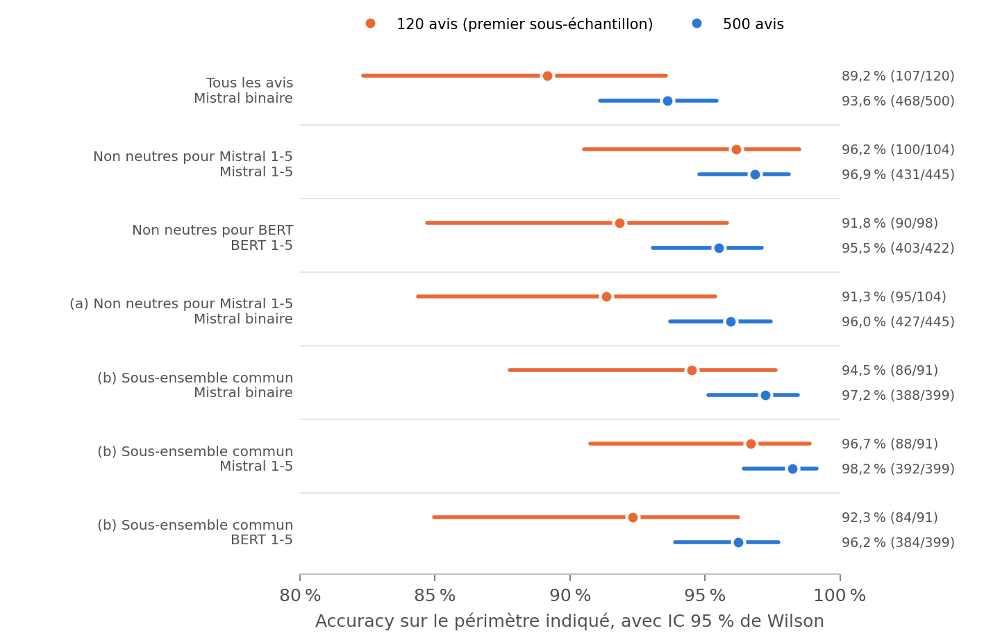
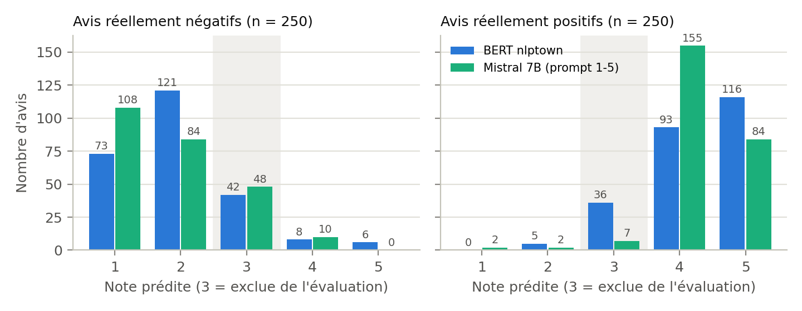
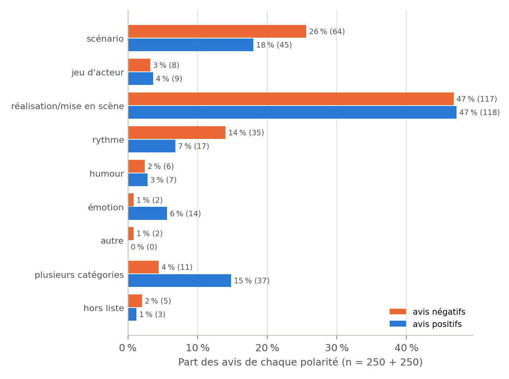

# Sentiment et thèmes d'avis en français : LLM local contre modèle spécialisé

Comparaison, en exécution 100 % locale sur une carte NVIDIA GTX 1060 (6 Go de VRAM), de deux familles de modèles pour analyser des avis rédigés en français :

- un **LLM généraliste** : Mistral 7B (quantifié Q4_K_M), servi par [Ollama](https://ollama.com), utilisé sans exemple (zéro-shot) ;
- un **modèle spécialisé** : [`nlptown/bert-base-multilingual-uncased-sentiment`](https://huggingface.co/nlptown/bert-base-multilingual-uncased-sentiment), un BERT multilingue affiné pour noter des avis produits de 1 à 5 étoiles.

Deux tâches sont traitées : la **classification de sentiment** (positif / négatif) et l'**extraction de thèmes**, où l'on compare KeyBERT et une catégorisation par LLM.

Ce dépôt documente aussi une correction méthodologique : la première comparaison entre les deux modèles était biaisée (voir [Correction méthodologique](#correction-méthodologique--le-biais-binaire--échelle-1-5)).

> **Pour une lecture rapide, ouvrir [`analyse_avis.ipynb`](analyse_avis.ipynb).** Il présente la démarche, le code et les résultats au même endroit, avec ses sorties enregistrées. Il relit les résultats des inférences sans relancer de modèle. Les données (`data/`) ne sont pas versionnées : voir [Données](#données) et [Reproduire](#reproduire).

---

## Problème

Une organisation qui collecte des verbatims clients veut savoir quelle est leur tonalité, et de quoi ils parlent. Deux questions guident le projet :

1. Sur une classification de sentiment en français, un LLM généraliste local fait-il jeu égal avec un modèle spécialisé, et à quel coût d'inférence ?
2. Pour les thèmes, une extraction statistique (KeyBERT) ou une catégorisation sémantique par LLM produit-elle un résultat plus exploitable ?

Les verbatims clients réels n'étant pas exploitables (données personnelles, RGPD, conditions d'utilisation des plateformes), le corpus public **Allociné** sert de substitut.

## Données

| | |
|---|---|
| Source | [`tblard/allocine`](https://huggingface.co/datasets/tblard/allocine) (licence MIT) : 200 000 critiques de films en français, écrites entre 2006 et 2020 |
| Labels | Dérivés de la note donnée par l'auteur : ≤ 2/5 = négatif, ≥ 4/5 = positif. Les notes 2,5 à 3,5 sont absentes du corpus, il n'y a **pas de classe neutre** |
| Découpage utilisé | Test : 20 000 avis (10 408 négatifs, 9 592 positifs) |
| Nettoyage (`01_dataset.py`) | 72 doublons et 48 avis de 20 caractères ou moins supprimés, 19 880 avis restants |
| Échantillon | 500 avis stratifiés, 250 négatifs et 250 positifs (`random_state=42`), dans `data/allocine_sample.csv` |
| Longueur des avis | Médiane 376 caractères (environ 64 mots), moyenne 528, maximum 1 987 |
| Sous-échantillon d'origine | 120 avis (57 négatifs, 63 positifs) pour les premiers tests avec Mistral ; 30 avis pour le premier test de thèmes |

## Matériel et modèles

| Modèle | Taille | Mémoire mesurée | Temps par avis (médiane) |
|---|---|---|---|
| Mistral 7B Q4_K_M (Ollama) | 7,2 milliards de paramètres, poids de 4,4 Go | 5,06 Go au total, dont 4,34 Go (≈ 86 %) sur le GPU : le reste tourne sur le CPU | 0,74 s (binaire), 0,66 s (1-5), 0,99 s (thèmes) |
| BERT nlptown | 167 millions de paramètres | 647 Mio, pic de 915 Mio en inférence | 45,7 ms (lots de 16) |
| KeyBERT, modèle par défaut `all-MiniLM-L6-v2` | 22,7 millions de paramètres | — | — |

Sur 6 Go de VRAM, dont 0,5 à 0,75 Go déjà pris par l'affichage, un LLM de 7 milliards de paramètres n'est utilisable qu'en version quantifiée sur 4 bits, et il dépasse encore légèrement la mémoire disponible. Les scripts ne chargent qu'une famille de modèles à la fois.

## Méthodologie

**Sentiment.** Trois configurations, avec un post-traitement identique à celui des scripts d'évaluation :

- *Mistral binaire* (`02`, `14`) : « Réponds uniquement par un seul mot : positif ou négatif ». La réponse vaut positif si elle contient « positif », négatif si elle contient « négatif ».
- *Mistral 1-5* (`08`, `14`) : « Note cet avis [...] de 1 à 5 [...] 3 = neutre/mitigé ». Les notes 1 et 2 donnent négatif, 4 et 5 positif ; la note 3 entraîne l'**exclusion** de l'avis.
- *BERT 1-5* (`04`) : note native de 1 à 5 étoiles, avec la même binarisation.

**Métriques** (`outils_eval.py`) :

- accuracy et couverture (part des avis effectivement classés) ;
- intervalle de confiance à 95 % de Wilson ;
- test de McNemar exact sur des prédictions appariées (mêmes avis), qui ne compte que les paires discordantes ;
- intervalle bootstrap apparié (10 000 tirages) de la différence d'accuracy ;
- accuracy *stricte*, où un avis exclu compte comme une erreur.

**Thèmes.**

- KeyBERT (`10`, `10_v2`, `11`) : sur le texte concaténé, puis avis par avis avec agrégation.
- Mistral (`12`, `15`) : chaque avis est rattaché à une catégorie parmi *scénario, jeu d'acteur, réalisation/mise en scène, rythme, humour, émotion, autre*.
- Normalisation et croisement avec le sentiment réel : `17`.

**Reproductibilité.** Les scripts d'origine (`02`, `08`, `12`) appellent Mistral avec les réglages par défaut d'Ollama, donc de façon non déterministe. Les relances (`14`, `15`) utilisent les mêmes prompts avec une graine fixe (`seed=42`), toujours à la température par défaut.

## Résultats

### Sentiment, 500 avis (`16_evaluation_500.py`)

| Périmètre | Méthode | Accuracy (corrects / n) | IC 95 % | Couverture |
|---|---|---|---|---|
| Tous les avis | Mistral binaire | **93,6 %** (468/500) | [91,1 ; 95,4] | 100 % |
| Avis non neutres pour Mistral 1-5 | Mistral 1-5 | **96,9 %** (431/445) | [94,8 ; 98,1] | 89 % |
| Avis non neutres pour BERT | BERT 1-5 | **95,5 %** (403/422) | [93,1 ; 97,1] | 84 % |
| (a) Avis non neutres pour Mistral 1-5 | Mistral binaire | 96,0 % (427/445) | [93,7 ; 97,4] | 89 % |
| (b) Sous-ensemble commun¹ | Mistral binaire | 97,2 % (388/399) | [95,1 ; 98,5] | 80 % |
| (b) Sous-ensemble commun¹ | Mistral 1-5 | 98,2 % (392/399) | [96,4 ; 99,1] | 80 % |
| (b) Sous-ensemble commun¹ | BERT 1-5 | 96,2 % (384/399) | [93,9 ; 97,7] | 80 % |

¹ Avis non neutres à la fois pour Mistral 1-5 et pour BERT.

Tests appariés sur les 500 avis :

| Comparaison (mêmes avis) | n | A seul juste | B seul juste | McNemar *p* | Différence A − B, IC bootstrap |
|---|---|---|---|---|---|
| Mistral 1-5 vs Mistral binaire, périmètre (a) | 445 | 5 | 1 | 0,22 | — |
| Mistral 1-5 vs Mistral binaire, périmètre (b) | 399 | 4 | 0 | 0,13 | +1,0 pt [+0,3 ; +2,0] |
| Mistral 1-5 vs BERT, périmètre (b) | 399 | 12 | 4 | 0,077 | +2,0 pts [0,0 ; +4,0] |
| Mistral binaire vs BERT, périmètre (b) | 399 | 12 | 8 | 0,50 | +1,0 pt [−1,3 ; +3,3] |

Si l'on compte les avis exclus comme des erreurs (accuracy stricte), on obtient 93,6 % pour Mistral binaire, 86,2 % pour Mistral 1-5 et 80,6 % pour BERT.





Les deux modèles n'utilisent pas la note 3 de la même façon :

- Mistral note 3 un total de 55 avis : 48 sont réellement négatifs, 7 réellement positifs ;
- BERT en note 3 un total de 78 : 42 négatifs, 36 positifs ;
- seuls 32 avis sont notés 3 par les deux modèles.

### Sentiment, 120 avis d'origine (`13_effet_prompt.py`, conservé pour comparaison)

| Périmètre | Méthode | Accuracy (corrects / n) | IC 95 % |
|---|---|---|---|
| Tous les avis | Mistral binaire | 89,2 % (107/120) | [82,3 ; 93,6] |
| Avis non neutres pour Mistral 1-5 | Mistral 1-5 | 96,2 % (100/104) | [90,5 ; 98,5] |
| Avis non neutres pour BERT | BERT 1-5 | 91,8 % (90/98) | [84,7 ; 95,8] |
| (a) Avis non neutres pour Mistral 1-5 | Mistral binaire | 91,3 % (95/104) | [84,4 ; 95,4] |
| (b) Sous-ensemble commun (91 avis) | Mistral binaire / Mistral 1-5 / BERT | 94,5 % / 96,7 % / 92,3 % | — |

Tests de McNemar sur ces 120 avis :

| Comparaison | Périmètre | Paires discordantes (A seul juste / B seul juste) | *p* |
|---|---|---|---|
| Mistral 1-5 vs Mistral binaire | (a) | 5 / 0 | 0,063 |
| Mistral 1-5 vs BERT | (b) | 5 / 1 | 0,22 |

**Stabilité.** Les 120 avis d'origine ont été relancés dans `14_mistral_500.py`. Entre ce passage et le passage d'origine :

- 97,5 % des prédictions binaires sont identiques ;
- 95,0 % des notes 1-5 sont identiques ;
- 98,3 % des notes sont identiques une fois binarisées.

Sur ce sous-échantillon, la relance donne 91,7 % en binaire, au lieu de 89,2 %. Ce sous-échantillon est par ailleurs plus difficile que la moyenne : BERT y obtient 91,8 %, contre 95,5 % sur les 500 avis.

### Correction méthodologique : le biais binaire / échelle 1-5

1. **Itération 1** (`06_comparaison.py`). Mistral binaire obtient 89,2 % sur 120 avis, BERT 91,8 % : BERT semble meilleur. Mais BERT écarte les avis qu'il note 3 (22 sur 120) alors que Mistral doit trancher sur tous. Les deux chiffres ne portent pas sur les mêmes avis, et les avis écartés sont les plus difficiles.
2. **Itération 2** (`08`, `09`). Mistral reçoit la même échelle 1-5, sur les mêmes 120 avis. Il obtient 96,2 % sur les 104 avis qu'il tranche et passe devant BERT.
3. **Vérification** (`13`, `16`). Comparer les méthodes *sur les mêmes avis* montre que **l'essentiel de l'écart vient du périmètre d'évaluation, pas du prompt** :
   - sur les 500 avis, le prompt binaire obtient 96,0 % sur les 445 avis que Mistral 1-5 tranche, contre 96,9 % pour l'échelle 1-5. L'écart propre au prompt est d'environ 1 point et n'est pas significatif (McNemar *p* = 0,22) ;
   - sur le sous-ensemble commun, Mistral binaire (97,2 %) n'est pas inférieur à BERT (96,2 %, *p* = 0,50). L'infériorité apparente de l'itération 1 était un artefact de la comparaison.

**Conclusion sur le sentiment.** À périmètre identique, Mistral 7B quantifié fait au moins aussi bien que BERT nlptown sur ce corpus. L'avantage de Mistral 1-5 sur BERT dans le sous-ensemble commun (+2,0 points, 12 paires discordantes contre 4) n'est **pas significatif** au seuil de 5 % (McNemar *p* = 0,077), et la borne basse de l'intervalle bootstrap est 0. Le résultat méthodologique est le suivant : une option d'abstention offerte à un seul modèle suffit à inverser le classement apparent. Il faut donc toujours comparer sur les mêmes avis et rapporter la couverture.

### Thèmes (`17_analyse_themes.py`, 500 avis)

**Conformité des réponses de Mistral** :

| Réponse | Avis | Part |
|---|---|---|
| exactement une catégorie de la liste | 432 | 86,4 % |
| conforme après normalisation (casse, articles, ponctuation, explication entre parenthèses) | 2 | 0,4 % |
| libellé inventé mais rattachable (ex. « acteur » → jeu d'acteur) | 10 | 2,0 % |
| plusieurs catégories malgré la consigne « catégorie principale » | 48 | 9,6 % |
| hors liste, non rattachable (« humeur », 8 fois) | 8 | 1,6 % |

Au total, 13,6 % des réponses brutes ne correspondent pas exactement à une catégorie, et 11,2 % restent inexploitables comme catégorie unique après normalisation.

**Thème × sentiment réel** (part des avis de chaque polarité) :

| Thème | Avis négatifs (n = 250) | Avis positifs (n = 250) |
|---|---|---|
| réalisation/mise en scène | 46,8 % | 47,2 % |
| scénario | 25,6 % | 18,0 % |
| rythme | 14,0 % | 6,8 % |
| plusieurs catégories | 4,4 % | 14,8 % |
| émotion | 0,8 % | 5,6 % |
| jeu d'acteur | 3,2 % | 3,6 % |
| humour | 2,4 % | 2,8 % |
| hors liste / autre | 2,8 % | 1,2 % |

Le scénario et le rythme sont davantage cités dans les avis négatifs, l'émotion et les réponses à plusieurs catégories dans les avis positifs. L'association entre thème et sentiment est significative mais modérée (khi-deux *p* = 1,2·10⁻⁵, V de Cramér = 0,26). « Réalisation/mise en scène » reçoit près de la moitié des avis dans les deux polarités : cette catégorie ne discrimine pas, et sert probablement de catégorie par défaut (hypothèse non vérifiée). Sur les 30 avis du premier test, 24 reçoivent la même catégorie qu'au passage d'origine.



**Comparaison avec KeyBERT.**

- *KeyBERT v1 et v2 (texte concaténé)* : les résultats sont inexploitables. Le modèle d'embeddings tronque silencieusement son entrée à 256 sous-mots, soit 0,6 % du texte concaténé : l'embedding du « document » ne représente que les deux premiers avis.
- *KeyBERT v3 (par avis)* : les résultats sont plus pertinents (« histoire », « jeu acteurs », « intrigue », « musique ») mais très dispersés. Sur les avis négatifs, on obtient 1 199 expressions distinctes pour 1 250 extractions, dont 97,6 % n'apparaissent qu'une fois. Le bruit reste important (« peut être », « bien très ») ainsi que les noms propres (Hitchcock, Mel Gibson). Seuls 14,9 % (avis négatifs) et 11,4 % (avis positifs) des expressions extraites contiennent un mot rattachable à l'une des catégories, d'après un lexique indicatif.
- *LLM* : la sortie est directement agrégeable et permet un croisement avec le sentiment. En contrepartie, la taxonomie est fermée (pas de thème imprévu), une catégorie domine sans discriminer, 11 % des réponses ne donnent pas une catégorie unique exploitable, et il n'existe aucune vérité terrain pour mesurer la justesse des affectations.

Pour un usage de synthèse, la catégorisation par LLM est plus exploitable. KeyBERT reste utile pour faire émerger du vocabulaire, à condition d'utiliser un modèle d'embeddings multilingue et un regroupement des variantes.

### Analyse d'erreurs (`18_analyse_erreurs.py`)

Sur les avis que chaque modèle tranche :

| Modèle | Erreurs | Négatifs classés positifs | Positifs classés négatifs |
|---|---|---|---|
| Mistral 1-5 | 14 sur 445 | 10 | 4 |
| BERT | 19 sur 422 | 14 | 5 |

Sur les 399 avis tranchés par les deux modèles, Mistral se trompe seul 4 fois, BERT seul 12 fois, et les deux ensemble 3 fois. Sur les 19 erreurs de BERT, Mistral 1-5 donne la bonne réponse 12 fois.

Typologie, issue d'une **annotation manuelle** à une catégorie par avis (`resultats/18_typologie_erreurs.csv`). Les effectifs sont petits et la typologie est indicative :

| Type d'erreur | Mistral 1-5 | BERT |
|---|---|---|
| Avis mitigé (éléments positifs et négatifs mêlés) | 6 | 5 |
| Texte ambigu ou en désaccord apparent avec le label | 4 | 2 |
| Ironie / sarcasme | 1 | 4 |
| Jugement implicite (référence externe, expression figée) | 1 | 3 |
| Élément isolé loué dans un avis négatif (un acteur) | 1 | 2 |
| Vocabulaire du sujet pris pour un jugement (film d'horreur « stressant ») | 1 | 1 |
| Négation / tournure | 0 | 1 |
| Sans explication apparente | 0 | 1 |

Exemples :

- *Ironie, erreur de BERT* : « Joie ! [...] on a enfin trouvé le film le plus bête de l'année » (BERT : 5/5).
- *Avis mitigé noté 4 par Mistral* : « un polar certes très conventionnel mais diablement sombre et habile [...] Néanmoins, tout cela n'est pas très mémorable » (label négatif).
- *Label discutable* : « Ce film est un chef d'oeuvre ! [...] Si vous voulez vraiment être dégoûté de Batman [...] je vous le conseille vivement ! » est un avis à label positif. Mistral, qui y lit de l'ironie, est compté faux.

Les erreurs de BERT relèvent plus souvent d'une lecture littérale (ironie, jugement implicite). Celles de Mistral sont surtout des avis négatifs nuancés qu'il note 4. Une part des « erreurs » des deux modèles tient au label lui-même : il dérive de la note donnée par l'auteur, que le texte ne reflète pas toujours.

## Limites

- **Taille d'échantillon** : 500 avis, et au plus 399 avis appariés. Un écart de 1 à 2 points entre modèles reste dans la marge d'incertitude.
- **Corpus proxy** : des critiques de films ne sont pas des verbatims clients. Le corpus exclut les avis mitigés (notes 2,5 à 3,5) ; les accuracies binaires sont donc probablement optimistes par rapport à un flux réel.
- **Référence spécialisée** : nlptown est spécialisé dans les avis *produits*, pas dans les films, et n'a pas été affiné sur Allociné. Un modèle affiné sur le domaine serait une référence plus exigeante.
- **LLM non déterministe** dans les scripts d'origine : les relances diffèrent de 2,5 % des prédictions binaires. Les passages sur 120 avis ont été faits avec Ollama 0.35.0, ceux sur 500 avis avec Ollama 0.40.2. Mistral déborde aussi légèrement de la VRAM (environ 14 % du modèle sur le CPU).
- **Un seul prompt par configuration**, en zéro-shot, avec un parsing permissif. Deux réponses binaires citent à la fois « positif » et « négatif », et la règle d'origine les classe positives.
- **Contamination possible** : le corpus est public depuis 2020, et les données d'entraînement de Mistral ne sont pas documentées.
- **Thèmes** : pas de vérité terrain, taxonomie fixée a priori et une seule étiquette par avis. KeyBERT utilise par défaut un modèle d'embeddings anglais, non testé avec un modèle multilingue.
- **Typologie d'erreurs** : un seul annotateur et de petits effectifs.

## Reproduire

Les données ne sont pas versionnées : `data/` contient le texte de critiques d'utilisateurs d'Allociné et de leurs prédictions. `01_dataset.py` retélécharge le corpus depuis Hugging Face et reproduit l'échantillon à l'identique (graine fixe). Les scripts d'analyse et le notebook lisent les CSV d'inférence, qu'il faut donc régénérer (`python run_all.py --tout`, environ 40 minutes) avant de les relancer. Les résultats chiffrés restent consultables dans le notebook et dans `resultats/`.

```bash
python -m venv venv
venv\Scripts\activate            # Windows ; source venv/bin/activate sous Linux/macOS
pip install torch==2.14.0 --index-url https://download.pytorch.org/whl/cu126
pip install -r requirements.txt
ollama pull mistral              # serveur Ollama démarré
```

`run_all.py` exécute les scripts dans l'ordre :

```bash
python run_all.py                  # analyses seules, une fois data/ régénéré : tableaux, figures et notebook (< 1 min)
python run_all.py --tout           # toute la chaîne, inférences comprises (≈ 40 min sur GTX 1060)
python run_all.py --etapes 14 15   # étapes choisies
```

Avec `--tout`, les étapes 02, 04, 08 et 12 réécrivent leurs CSV, et les sorties de Mistral y changent légèrement d'un passage à l'autre. Les étapes 14 et 15 sauvegardent chaque réponse au fil de l'eau et reprennent là où elles se sont arrêtées.

| Ordre | Script | Rôle | Sortie |
|---|---|---|---|
| 01 | `01_dataset.py` | Chargement, nettoyage, échantillon 250/250 | `data/allocine_sample.csv` |
| 02 / 03 | `02_sentiment_llm.py`, `03_evaluation_llm.py` | Mistral binaire, 120 avis | `data/resultats_llm.csv` |
| 04 / 05 | `04_sentiment_bert.py`, `05_evaluation_bert.py` | BERT, 500 avis | `data/resultats_bert.csv` |
| 06 | `06_comparaison.py` | Comparaison de l'itération 1 (biaisée) | console |
| 08 / 09 | `08_sentiment_llm_stars.py`, `09_evaluation_llm_stars.py` | Mistral 1-5, mêmes 120 avis | `data/resultats_llm_stars.csv` |
| 10 | `10_keywords.py`, `10_keywords_v2.py` | KeyBERT sur texte concaténé (v1, v2) | console |
| 11 | `11_keywords_v3.py` | KeyBERT par avis (v3) | console |
| 12 | `12_themes_llm.py` | Thèmes par LLM, 30 avis | `data/resultats_themes_llm.csv` |
| 13 | `13_effet_prompt.py` | Effet du prompt, IC, McNemar (120 avis) | `resultats/13_*.csv` |
| 14 | `14_mistral_500.py` | Mistral binaire et 1-5, 500 avis | `data/resultats_llm_500.csv`, `data/resultats_llm_stars_500.csv` |
| 15 | `15_themes_llm_500.py` | Thèmes par LLM, 500 avis | `data/resultats_themes_llm_500.csv` |
| 16 | `16_evaluation_500.py` | Analyse de 13 refaite sur 500 avis, bootstrap, stabilité | `resultats/16_*.csv` |
| 17 | `17_analyse_themes.py` | Normalisation des thèmes, thème × sentiment | `resultats/17_*.csv` |
| 18 | `18_analyse_erreurs.py` | Erreurs et typologie | `resultats/18_*.csv` |
| 19 | `19_figures.py` | Graphiques | `figures/` |
| — | `analyse_avis.ipynb` | Synthèse lisible : démarche, code et résultats | sorties enregistrées dans le notebook |

Fichiers annexes :

- `outils_eval.py` : fonctions communes aux scripts 13 à 19 ;
- `voir_erreur.py` : inspection rapide des erreurs du prompt binaire ;
- `mesures/` : scripts de mesure (troncature de KeyBERT, mémoire GPU, temps d'inférence, relance de Mistral) et leurs résultats.

Notes sur la numérotation :

- `12_themes_llm.py` s'appelait `11_themes_llm.py`, renommé pour supprimer le doublon avec `11_keywords_v3.py` ;
- le numéro 07 n'existe pas ;
- `10_keywords.py` et `10_keywords_v2.py` sont deux versions de la même étape.
